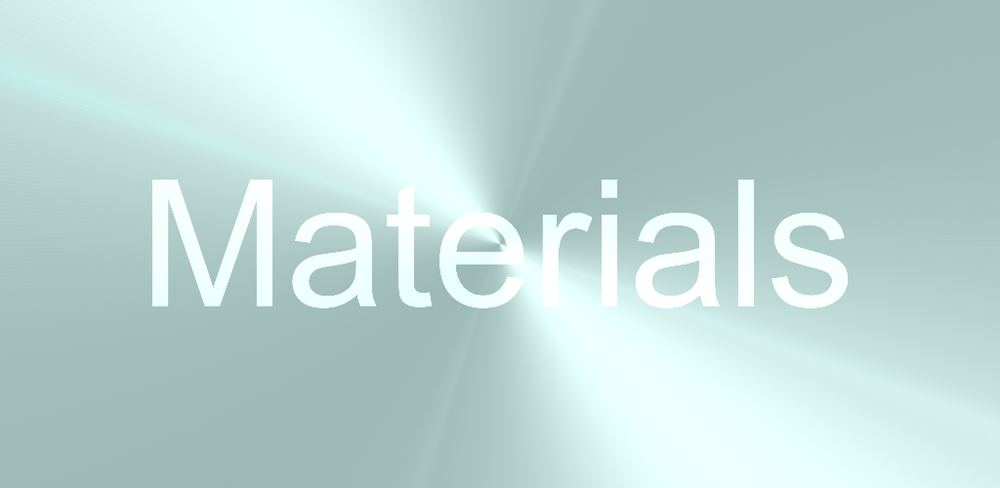
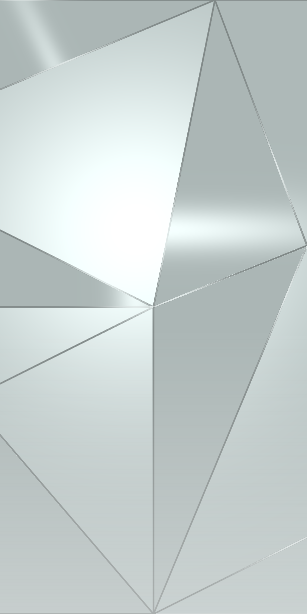
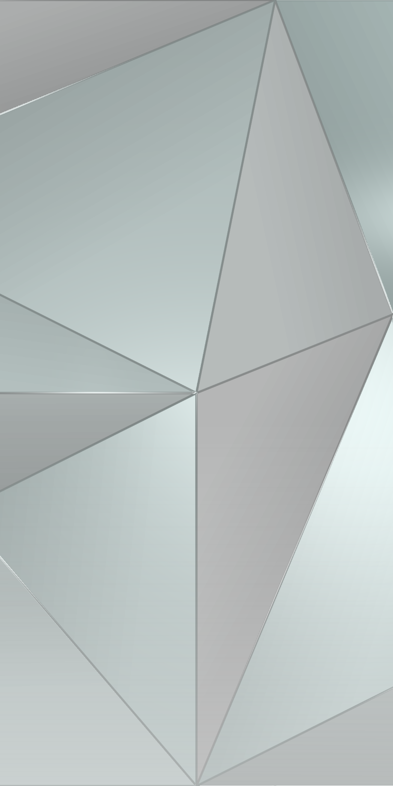
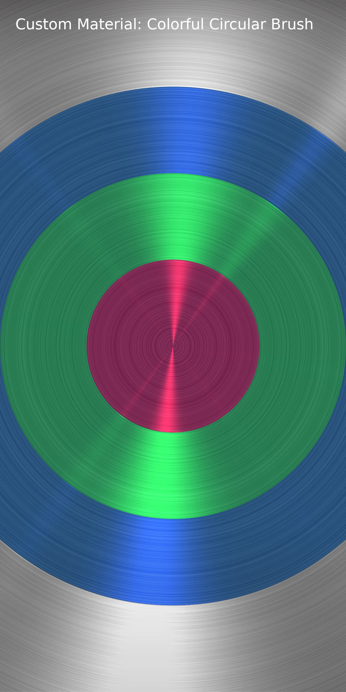
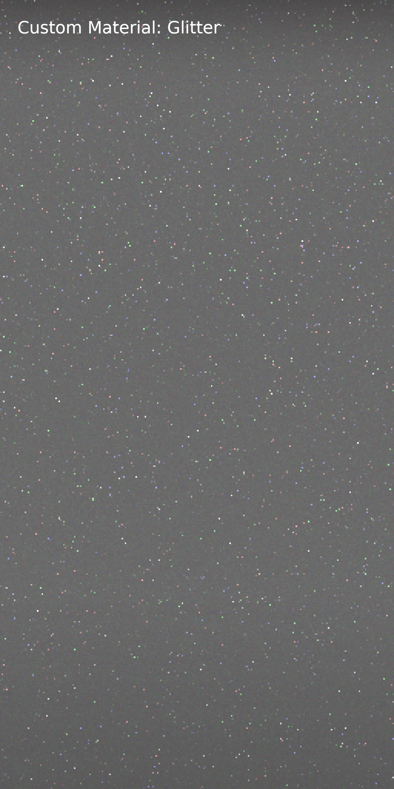

# Materials Live Wallpaper

A live wallpaper that renders materials and uses device's sensors to reflect lights from different directions on them.

## Screenshots

  
  
  
  

# Custom Materials

See [Custom Materials](https://github.com/Reminimalism/MaterialsLiveWallpaperCustomMaterials) for samples and instructions on making your own custom materials.

# About the software design

The code is not intended to be beautiful,
to make the development process faster
as I couldn't allocate a lot of time to it
and it's not a large project either.
